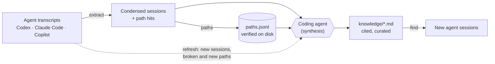

# ResearchAtlas

[](https://github.com/benedictdavon/ResearchAtlas/actions/workflows/ci.yml)


[](https://github.com/astral-sh/ruff)
[](LICENSE)

**Give your coding agents a memory of your research.** ResearchAtlas mines past OpenAI Codex, Claude Code and
GitHub Copilot sessions, verifies every path they mention against the filesystem, and keeps a small, cited
knowledge base that new agent sessions read before guessing where your data is.

Long-running research leaves its context scattered across hundreds of agent transcripts: which dataset lives where,
which experiment produced which result, why a decision was made. A fresh session knows none of it, so it searches
the disk, guesses paths or asks you. In a benchmark on a real research project, a one-line pointer to the atlas
**halved token use, cut wall time by more than half and raised the pass rate** for both Claude Code and Codex
([results](#does-it-help)).

## Contents

- [Try the demo](#try-the-demo)
- [How it works](#how-it-works)
- [Installation and usage](#installation-and-usage)
- [Does it help?](#does-it-help)
- [Scope](#scope)
- [Documentation](#documentation)
- [Development](#development)

## Try the demo

The demo builds a fictional bird-song project in a temp folder, with four synthetic sessions from all three agents,
and runs the whole workflow. No configuration needed:

```bash
git clone https://github.com/benedictdavon/ResearchAtlas.git && cd ResearchAtlas
python examples/demo/run_demo.py --dir /tmp/atlas-demo
```

A new session asks where the labels are. `find` answers from the curated knowledge first, with verification marks
(`✓`/`✗`) and citations back to the sessions, then from verified paths, then from raw transcripts:

```text
$ researchatlas find labels
== knowledge: 5 matching sections (best first)
  projects/birdsong/knowledge/datasets.md:9  Species labels
      :10  - **Current:** `BS/data/labels/v2/labels.csv` ✓ 2026-03-16, columns `clip,species`. [claude:8d2f4c1a 2026-03-09]
      :11  - **Superseded:** `BS/data/labels/v1/labels.csv` ✗ 2026-03-16, removed after the `site_b` relabel.
  ...
== paths.jsonl: 2 matching paths (existing first, most sessions first)
  /tmp/atlas-demo/research/birdsong/data/labels/v2/labels.csv  status=exists n_sessions=1
  /tmp/atlas-demo/research/birdsong/data/labels/v1/labels.csv  status=missing n_sessions=1
== sessions: 2 matching transcripts (leads, not verified; most matches first)
  ...
```

A week later the raw recordings move to an archive share. `refresh` catches the new session, the cited path that
broke, and the new location:

```text
$ researchatlas refresh
New sessions (not reviewed): 1
  codex:019c5f72-0a4d  2026-03-20 16:40  root  sha=f7b165410cde  The repo disk is full. Move the March raw recordings to the archive share.

Cited paths no longer OK (missing or unreachable): 1
  missing  /tmp/atlas-demo/research/birdsong/data/raw/2026-03-field  <- INDEX.md:12, datasets.md:5

New paths not yet in knowledge/ (exists, n_sessions >= 1, not in paths.jsonl before this refresh): 1; showing 1
     1 sess  last 2026-03-20 16:40  /tmp/atlas-demo/archive/birdsong/2026-03-field
```

See [examples/demo](examples/demo/) for the generated knowledge base and a walkthrough.

## How it works



1. **`extract`** selects the sessions that belong to your project (by working directory, parent session or path
   mention), condenses each to Markdown and harvests the absolute paths it mentions. It is incremental: unchanged
   transcripts are reused.
2. **`paths`** aggregates those paths and checks each one on disk, with per-path timeouts so a hung network mount
   can't stall the run.
3. **Synthesis.** A coding agent writes `knowledge/` (datasets, experiments, decisions) from the condensed sessions
   and verified paths, following the rules in [docs/knowledge-format.md](docs/knowledge-format.md). Every claim must
   cite its source.
4. **`refresh`** reports what changed since the last review: new or changed sessions, cited paths that broke, and
   frequently used new paths. An agent applies the report, then **`mark-reviewed`** records the covered sessions in
   a review ledger.
5. **`find`** gives agents one search over knowledge sections, verified paths and condensed sessions.

The deterministic steps use no LLM, and everything is plain Markdown and JSONL: no database, no service, no
dependencies.

### Design highlights

- **Transcripts are leads, not truth.** "The data is at X" in a past session counts only after a timeout-guarded
  check confirms X exists. Knowledge files mark paths `✓` or `✗` with the check date.
- **Every claim cites its source**: `[codex:<id13> <date>]`, `[claude:<id8> <date>]`, `[copilot:<id8> <date>]` or
  `[file:<path>]`, so you can trace it back and re-verify it.
- **Review state is explicit.** The ledger stores a content hash per reviewed session, so a session that grows after
  review shows up again, and `mark-reviewed` only accepts sessions listed in the report you worked from.
- **Self-correcting.** `refresh` flags sessions that consulted the atlas and then called something in it wrong or
  stale, so those get reviewed first.
- **Every choice is documented.** 29 numbered [design decisions](docs/design-decisions.md) record the alternatives
  and the reasons, and the code cites them.

## Installation and usage

Requires Python 3.11 or newer; there are no runtime dependencies.

```bash
pip install git+https://github.com/benedictdavon/ResearchAtlas.git
researchatlas init                        # writes ~/.researchatlas/config.toml (or $RESEARCHATLAS_HOME)
$EDITOR ~/.researchatlas/config.toml      # transcript locations, project roots, data mounts
researchatlas extract                     # condense + index matching sessions into work/
researchatlas paths                       # verify harvested paths → work/<project>/paths.jsonl
researchatlas find "dataset" "train"      # search (all words in one section / path / message)
```

Working from a clone instead? `python atlas.py <command>` runs the same CLI, and the checkout itself is the atlas
home, so `config.toml`, `work/` and `projects/` sit next to the code (all gitignored).

Then have an agent write `projects/<project>/knowledge/` in the atlas home from the condensed sessions and verified
paths, using the [initial-build prompt](docs/prompts/initial-build.md); the format is in
[docs/knowledge-format.md](docs/knowledge-format.md). [Getting started](docs/getting-started.md) walks through the
whole setup. Once the knowledge exists, keep it current:

```bash
researchatlas refresh | tee work/<project>/refresh_$(date +%Y%m%d).txt   # sessions to review, broken cited paths, new paths
# an agent applies the report to knowledge/ (docs/prompts/incremental-update.md), then:
researchatlas mark-reviewed --report work/<project>/refresh_<YYYYMMDD>.txt
```

See the [refresh guide](docs/refresh-guide.md) for the full workflow.

### Point your agents at it

Add a few lines to your global agent instructions (`~/.codex/AGENTS.md`, `~/.claude/CLAUDE.md`) or to the research
repo's `AGENTS.md`:

```markdown
For <project> data locations and research history, read
~/.researchatlas/projects/<project>/knowledge/INDEX.md before guessing paths or asking the user.
Search with: researchatlas find <words>
```

### Copilot chats from a Windows PC (optional)

VS Code Chat logs live on the client machine. [tools/copilot_sync.py](tools/copilot_sync.py) (Python 3.9+, stdlib)
previews and uploads only the chat logs of the workspaces under `--root` over SSH. The server side receives them
with `researchatlas import-copilot`. Preview is the default:

```bash
python tools/copilot_sync.py --root /home/user/research/demo_project
python tools/copilot_sync.py --root /home/user/research/demo_project --upload --host user@server --atlas-dir /home/user/.researchatlas
```

## Does it help?

A sandboxed four-arm benchmark ([full report](docs/benchmark.md)) ran Claude Code and
Codex non-interactively on 9 research questions about a real project, plus 2 control questions. The arms were:

- `none`: no atlas
- `atlas`: the pointer line
- `dump`: read the whole knowledge dir
- `hint`: a user-typed folder hint

Ratios are relative to `none`: the geometric mean over questions, with bootstrap 95% CIs.

| agent | arm | tokens × none | cost × none | wall time × none | pass rate | cost per pass |
|---|---|---|---|---|---|---|
| Claude Code | none | – | – | – | 19/26 | $0.50 |
| Claude Code | **atlas** | **0.49** (0.41–0.58) | **0.65** (0.56–0.75) | 0.41 | **26/27** | **$0.24** |
| Claude Code | dump | 1.57 | 2.62 | 0.47 | 17/18 | $0.95 |
| Claude Code | hint | 1.05 | 1.07 | 0.73 | 13/18 | $0.58 |
| Codex | none | – | – | – | 13/15 | $0.44 |
| Codex | **atlas** | **0.42** (0.34–0.53) | **0.59** (0.50–0.68) | 0.43 | **14/15** | **$0.24** |
| Codex | dump | 3.74 | 2.35 | 1.87 | 11/13 | $1.06 |
| Codex | hint | 0.92 | 0.98 | 0.99 | 10/15 | $0.53 |

- The atlas pointer roughly **halved token use** and **cut wall time by more than half**, with the same or better
  answer quality.
- On control questions that don't need the atlas, the pointer cost nothing measurable (0.96× and 1.00× tokens).
- Dumping the whole knowledge base into context gave similar quality at 1.6–3.7× the tokens.
- A folder hint did not substitute for the atlas.

A follow-up with smaller models (Claude Haiku 5.5 and gpt-6-luna, `none` and `atlas` arms only) showed a larger
quality gain: pass rates rose from 17/27 to 26/27 for both agents, at 0.55× and 0.37× the tokens, and cost per
passing answer fell to $0.05 and $0.02.

These numbers are from one project with 9 questions, so treat them as indicative. The benchmark cost $91.54 in
API spend and the follow-up $5.67; the [report](docs/benchmark.md) has the questions, isolation, grading,
per-question results and limitations.

## Scope

ResearchAtlas was built for one long-running research project: a single repository of dated experiment folders
on shared data mounts, worked on daily with several coding agents, where the same datasets and decisions come up
across hundreds of sessions. It has been in use there since October 2026, built from 261 sessions. It has not yet
been tried on several projects at once, on knowledge shared across projects, on teams, or on very different
project shapes. [Background and scope](docs/background.md) says what it assumes and what is untested.

## Documentation

| Document | What it covers |
|---|---|
| [Getting started](docs/getting-started.md) | Install, configure, build the first knowledge base, connect your agents |
| [Refresh guide](docs/refresh-guide.md) | Keeping a knowledge base current as new sessions arrive |
| [CLI](docs/cli.md) · [Configuration](docs/configuration.md) · [Knowledge format](docs/knowledge-format.md) | Reference for commands, `config.toml` and the knowledge files |
| [Transcript formats](docs/transcript-formats.md) | How Codex, Claude Code and Copilot store sessions, and how each is parsed |
| [Background and scope](docs/background.md) | Why it exists, what it assumes, what hasn't been tested |
| [Architecture](docs/architecture.md) · [Design decisions](docs/design-decisions.md) · [Roadmap](docs/roadmap.md) | Internals, D1–D29 with alternatives and reasons, deferred features |
| [Benchmark](docs/benchmark.md) | The full evaluation: setup, results, cost, limitations |
| [Agent prompts](docs/prompts/) | Building the first knowledge base and applying refresh reports |

## Development

```bash
pip install -e . ruff==0.17.4
python -m unittest discover -s tests      # ~200 tests on synthetic transcripts, about a second
ruff check . && ruff format --check .
```

CI runs the tests on Ubuntu and macOS with Python 3.11 to 3.13. See [CONTRIBUTING.md](CONTRIBUTING.md) for the
guidelines and [CHANGELOG.md](CHANGELOG.md) for release notes.

| Path | What |
|---|---|
| `atlaslib/` | CLI and library: `sources/` (Codex, Claude Code, Copilot parsers), `extract`, `paths`, `refresh`, `review`, `find` |
| `tools/copilot_sync.py` | Client-side Copilot chat uploader |
| `examples/demo/` | End-to-end demo on a fictional project |
| `tests/` | Unit tests and a demo smoke test, synthetic data only |
| `docs/` | Guides, references, design, benchmark and agent prompts ([index](docs/README.md)) |

## License

[MIT](LICENSE) © 2026 Benedict Davon M
